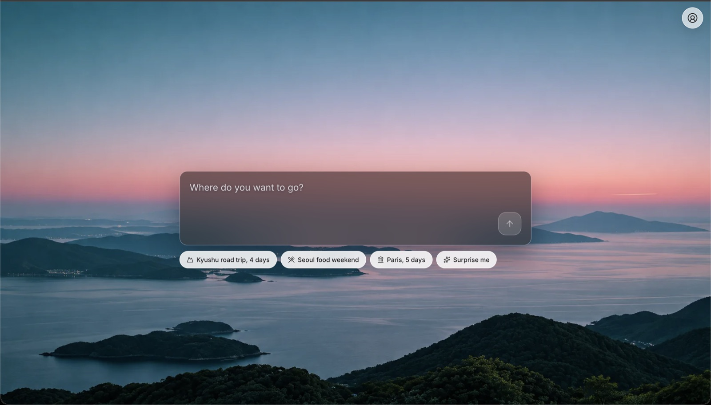
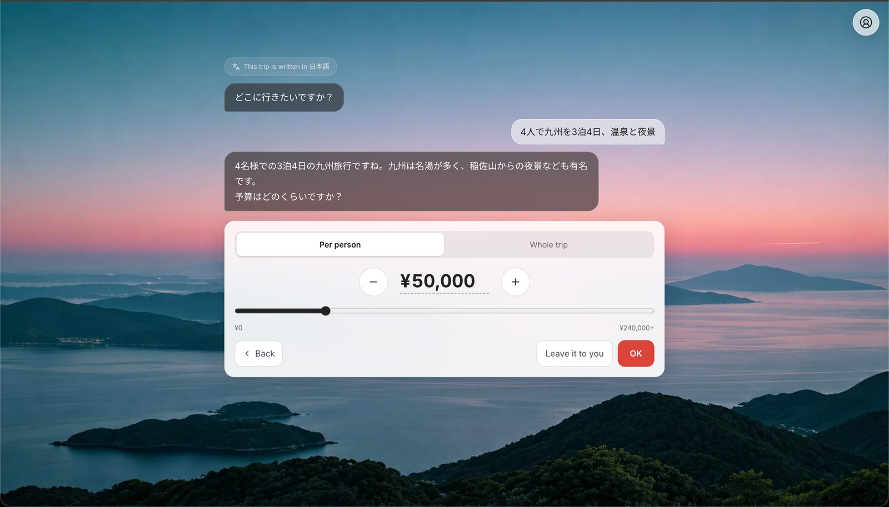
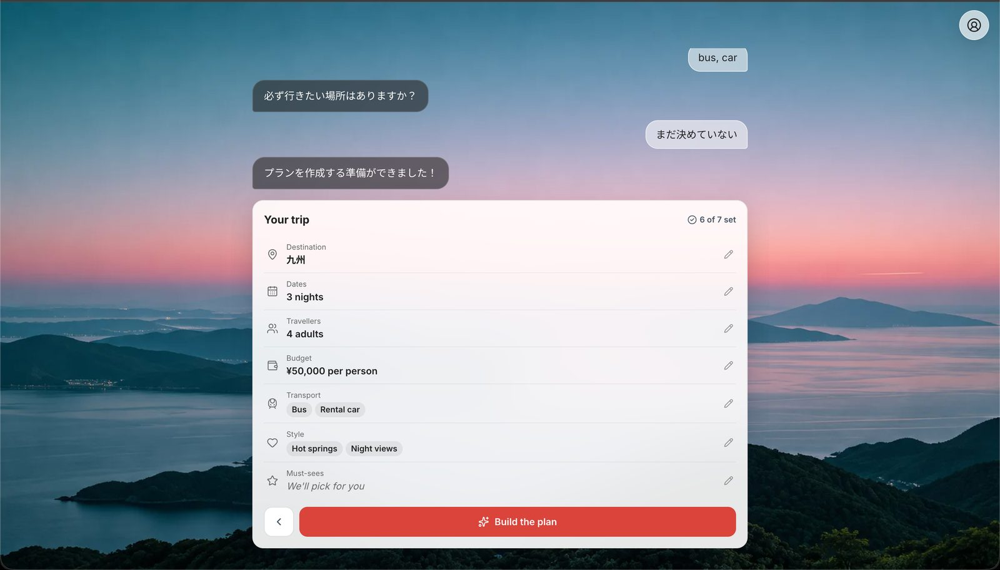
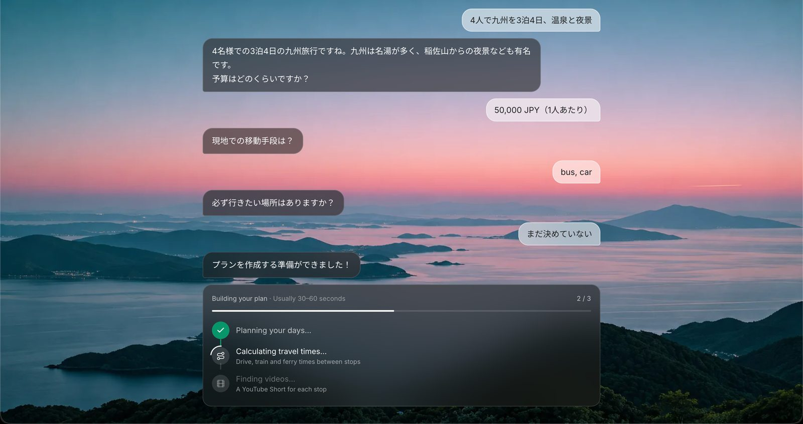
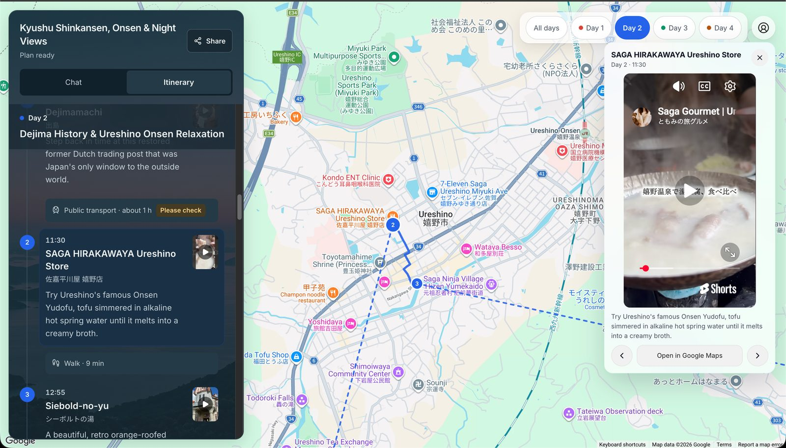
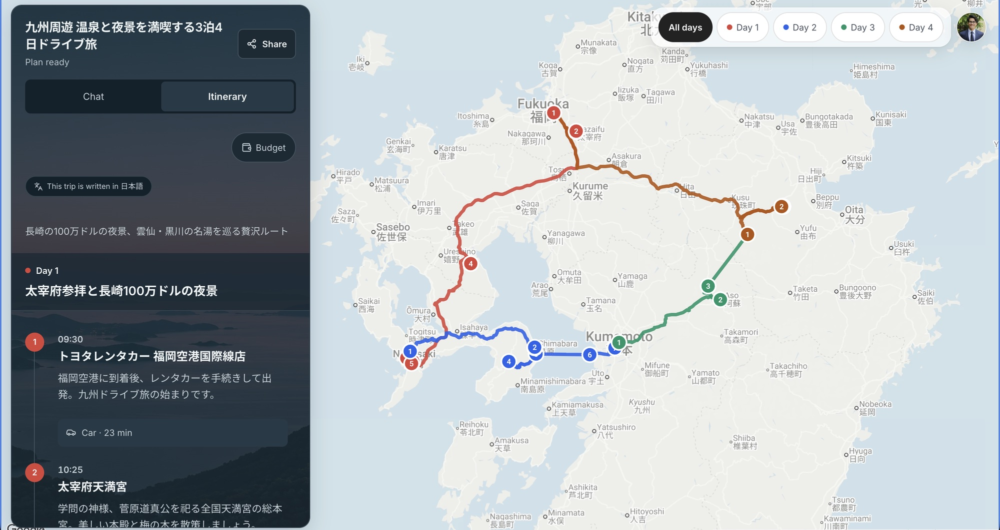
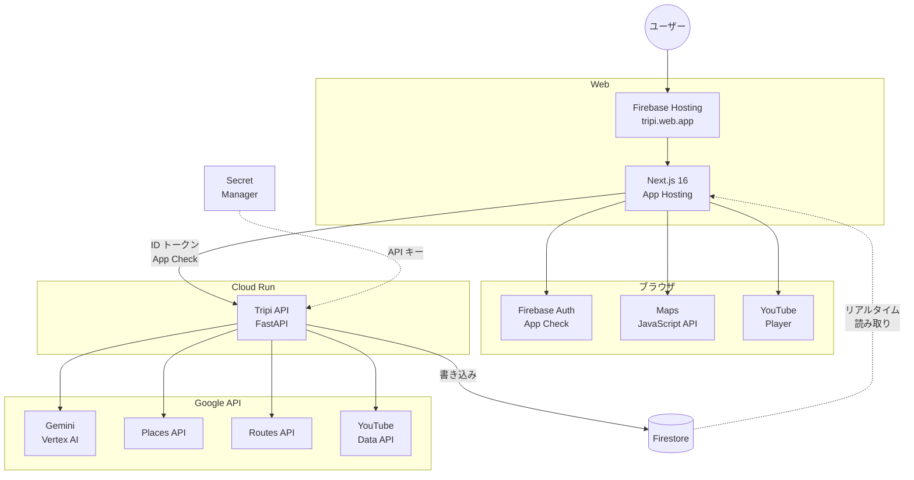
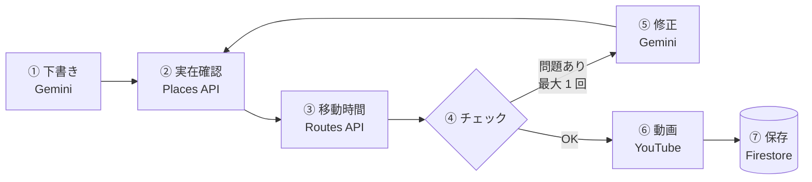

# Tripi

> **チャットで答えるだけで、「本当に回れる」旅行プランを。**
> 実在するスポット・実際の移動時間・スポットごとの YouTube ショートが入った日ごとのプランを AI が作り、リンクひとつで友だちと共有できます。




| ① 自由な文章で伝える | ② 条件を確認して「プランを作成」 |
| --- | --- |
|  |  |
| **③ 作成中の進捗を表示** | **④ 1 日のルートとスポットのショート動画** |
|  |  |

**⑤ 完成したプラン：4 日間すべてのルートを地図で一覧**



## デモ・関連リンク

| 種別 | URL |
| --- | --- |
| デプロイ URL | **https://tripi.web.app** （Google アカウントでログイン。共有リンクはログイン不要で閲覧可） |
| 設計判断の記録 | [`docs/decisions.md`](docs/decisions.md)（主要な 20 件：比較した選択肢・採用理由・決めた人） |
| AI 活用ログ | [`AI_USAGE_LOG.md`](AI_USAGE_LOG.md) |

## チーム情報

| 項目 | 内容 |
| --- | --- |
| ハッカソン | GDGoC Japan DevFest Hackathon 2026 |
| テーマ | Own the Why, Build with Intent. |
| カテゴリ | 観光 |
| チーム名 | Kyu_cat |
| プロダクト名 | Tripi |

### メンバー

| GitHub | 担当 |
| --- | --- |
| [@NazmulHayat](https://github.com/NazmulHayat) | バックエンド（チャット・認証・データ基盤）、インフラ・デプロイ |
| [@raghavraibansal](https://github.com/raghavraibansal) | バックエンド（プラン生成エンジン：Planner・Places・Routes・YouTube） |
| [@SomaTakata](https://github.com/SomaTakata) | フロントエンド開発（Next.js）・UI デザイン・プロダクト企画 |

## プロダクト概要

### 解決したい課題

友だちと旅行を計画すると、情報が LINE のメッセージ・Google マップのリンク・YouTube のリンクにばらばらに散らばり、「どこに行くのか」「誰が何を決めたのか」が分からなくなります。そして **移動時間が現実的かどうかは、誰も確認しません**。

一方で、AI にプランを頼むと「存在しない店」「定休日の観光地」「車で 3 時間かかる 2 か所を 1 時間で回る日程」がもっともらしく出てきます。AI の文章は速いけれど、そのまま信じて旅行には行けません。

Tripi は、この 2 つの問題を同時に解きます。**AI の発想力で下書きし、Google の実データで検証してから** 見せる旅行プランナーです。

### ターゲットユーザー

旅行を計画したい **すべての人**（行き先・目的・年代を問わない）。代表的な例：

- 友人と旅行を計画する大学生
- 土地勘のない地域へ行く人（訪日外国人を含む）
- どこをどの順番で回れるかを短時間で決めたい人

### コア機能

| ID | 機能 | 内容 |
| --- | --- | --- |
| F1 | 質問カード付き AI チャット | 行き先・日程・人数・予算・移動手段・好み・必ず行きたい場所を、カードのタップでも自由入力でも回答できる |
| F2 | 検証済みプランの生成 | Gemini の下書きを Places API（実在・営業時間）と Routes API（実際の移動時間）で検証し、問題があれば 1 回だけ AI に直させる |
| F3 | 地図付き旅行ページ | 日ごとに色分けしたルート・番号付きピン・タイムライン・費用の目安・「要確認」バッジ |
| F4 | スポットごとの YouTube ショート | 旅行動画を優先して選んだショートを、旅程の順にスワイプで見られる |
| F5 | 共有リンク（閲覧のみ） | ログインなしでスマホから閲覧。LINE に貼れるテキスト版もコピーできる |
| F6 | チャットでプランを修正 | 条件のチップや「2 日目をもっとゆったりに」などの依頼から「プランを更新」。変わった日だけを検証し直し、調べ済みの場所・ルート・動画は再利用する（D27） |
| F10 | 英語・日本語 | UI も AI の出力も選んだ言語に追従。行き先は世界中どこでも |

### 使い方（エンドツーエンドの流れ）

1. Google でログインし、「新しい旅行」を始める
2. AI の質問カードに答える（例：「九州に行きたい」→ 日程をカレンダーで選ぶ → 人数・予算・移動手段・好みをタップ）
3. 「高千穂峡と稲佐山の夜景は絶対」と入力すると、AI が条件として取り込む
4. プラン作成（約 30〜45 秒）。進捗カードで「日程の組み立て → 移動時間の計算 → 動画探し」を表示
5. 地図で日ごとのルートを確認し、各スポットのショート動画を見る
6. 共有リンクを LINE に送る。友だちはログインなしで閲覧できる

デモは福岡発の九州ドライブ旅行（3 泊 4 日）です。

## Own the Why — 主な設計判断

テーマ「Own the Why, Build with Intent.」に沿って、AI の提案をそのまま採用せず、**重要な判断はすべて 2〜3 案を比較し、人が決めて記録** しました（主要な 20 件：[`docs/decisions.md`](docs/decisions.md)）。代表的なものです。

| 判断 | 採用 | 採用しなかった案 | 理由 |
| --- | --- | --- | --- |
| 次に何を聞くか（D7） | **サーバーのコードが決める** | LLM に決めさせる | 質問の抜け・重複・ループが起きない。AI は自由入力を構造化データに変換するだけ |
| AI の下書きをどう扱うか | **Places・Routes で必ず検証** | AI の出力をそのまま表示 | LLM は場所と移動時間を作り話する。存在しない店・30 km 以上離れた同名スポット・都市名だけの「スポット」は除外（D8） |
| Planner のモデル設定（D4） | Flash＋既定の思考量 | Pro／思考量を下げる | Pro は遅く高い。思考量を下げると速いがプランの質が落ちる。**質を優先** |
| プラン作成の速度（D6） | 修正は 1 回だけ、変更した日だけを返させる | 問題ごとに AI を呼び直す／全体を書き直させる | 計測：最大 93 秒 → 約 31〜43 秒。修正 1 回あたり約 30 秒 → 約 5 秒。質は落とさない |
| チャットの応答速度（D5） | Concierge は最小の思考量 | 既定の思考量 | 抽出結果は同じまま、応答が 2.8〜4.4 秒 → 1.1〜1.8 秒 |
| 進捗の伝え方 | Firestore のリアルタイム更新 | SSE ストリーミング | 共有のためにリスナーは元々必要。仕組みが 1 つで済む |
| 費用と移動時間の表示 | 常に「概算」の幅、計算できない区間は「要確認」 | 正確な金額・時間に見せる | リアルタイムの価格データはない。分からないことを分からないと示すのが誠実 |
| Places のキャッシュ（D10） | 「検索語 → placeId」だけを保存 | 結果をまるごと保存 | Google の利用規約で保存が許されるのは placeId のみ |

## 使用している Google 技術と選定理由

| サービス | 役割 | 選んだ理由 |
| --- | --- | --- |
| **Gemini 3.5 Flash（Vertex AI）** | 自由入力の理解（Concierge）、旅程の下書きと修正（Planner） | 東京リージョンで低遅延。サービスアカウント認証でキーが不要、クラウドクレジットが使える（D1・D3） |
| **Places API (New)** | スポットの実在確認・座標・営業時間・現地語名 | AI の下書きを「実在する場所」に結びつける。営業時間で「着いたら閉まっている」を検出 |
| **Routes API** | 区間ごとの実際の移動時間とルート | AI の推測ではなく実際の所要時間で 1 日の時刻を組み直す |
| **Maps JavaScript API** | 地図・日ごとのルート・番号付きピン | 旅程を地図で一目で理解できる |
| **YouTube Data API v3** | スポットごとのショート動画 | 写真より雰囲気が伝わる。旅行動画を優先して選び、7 日間キャッシュ |
| **Cloud Run** | バックエンド API（FastAPI） | コンテナをそのままデプロイでき、負荷に応じて自動スケール。審査期間中は 1 台を常時起動（D20） |
| **Firebase App Hosting** | フロントエンド（Next.js） | Next.js を設定なしでビルド・配信できる |
| **Cloud Firestore** | 旅行・チャット・プランの保存とリアルタイム同期 | 進捗表示も共有ページも、同じリスナーでリアルタイムに更新 |
| **Firebase Authentication** | Google ログイン・共有ページの匿名ログイン | 共有相手にアカウント作成を求めない |
| **Firebase App Check** | API の不正利用防止（reCAPTCHA Enterprise） | ボットによる AI・Maps の課金を防ぐ |
| **Secret Manager** | サーバー用 API キーの管理 | キーをコードにも環境ファイルにも置かない |

## アーキテクチャ



- **書き込むのは API だけ**：ブラウザは Firestore を読むだけ。旅行データはメンバーしか読めない（セキュリティルール）
- **キーはサーバーに**：Places・Routes・YouTube のキーは Secret Manager。Gemini はサービスアカウント認証でキー不要
- **画面はリアルタイム**：チャット・進捗・プランは Firestore のリスナーで即座に反映され、共有相手にも同じ内容が届く

### プラン生成パイプライン



| ステップ | 内容 |
| --- | --- |
| ① 下書き | Gemini が条件とチャット全文から、日ごとのスポット・時刻・移動手段・費用の幅を作る（約 30 秒） |
| ② 実在確認 | 全スポットを並列に検索。別の国・遠すぎる同名スポット・都市名だけのものは不採用 |
| ③ 移動時間 | 全区間を並列に計算し、実際の所要時間で 1 日の時刻を組み直す |
| ④ チェック | 見つからないスポット・到着時に閉まっている・5 時間超の運転・深夜 0 時超えを検出 |
| ⑤ 修正 | 問題をまとめて 1 回で渡し、変更した日だけを返させる。変わったスポットだけを再検証 |
| ⑥ 動画 | スポットごとに旅行系のショートを選ぶ（キャッシュ済みなら API を呼ばない） |
| ⑦ 保存 | Firestore に保存し、画面にリアルタイムで反映 |

AI の出力はすべて Pydantic モデルで検証し、形式が崩れていれば 1 回だけ再試行します。

## セキュリティ・スケーラビリティ・保守性

**セキュリティ**
- API キーやサービスアカウントの鍵はリポジトリに含めない。サーバー用キーは Secret Manager、Gemini はサービスアカウント経由（キー不要）
- ブラウザに渡すキーは Maps JavaScript API の 1 本だけで、リファラーと API で制限
- クライアントは Firestore を読むだけ。書き込みはすべて API 経由（Admin SDK）で、旅行データはメンバーだけが読める（ルールはエミュレーターでテスト）
- すべての API 呼び出しに Firebase ID トークンと App Check トークンが必要
- ユーザーの入力は「データ」としてプロンプトに渡し、指示としては扱わない（プロンプトインジェクション対策、D13）
- 共有リンクの ID は推測できない 22 文字のランダム文字列
- 悪用・コスト対策（D21）：
  - 1 日あたり：ログインユーザーは旅行 10 件・プラン 10 回、ゲストは 3 件・3 回。アプリ全体でもプラン 200 回まで
  - 1 旅行あたりメッセージ 40 件、自由入力は 2 秒に 1 回、共有の閲覧メンバーは 50 人まで
  - 失敗したプランは回数に数えない。上限に達したら理由を表示する
  - Places の検索は上限・ステップのチェックの後だけ行う（上限超えのリクエストで有料 API を呼ばない）
- 入力の検証（D22・D23・D26）：
  - リクエスト本文は 16 KB まで、チャットは 1000 文字まで、パスの ID は形式をチェック
  - 旅行は 20 日まで・今日から約 2 年以内、予算は 1 以上、人数は 20 人まで（大人 1 人以上、乳幼児は大人 1 人に 1 人、子どもは大人 1 人に 4 人まで）
  - 行き先はサーバーが必ず地図で検索（クライアントが送った placeId や座標は使わない）
  - 通貨は ISO コードのみ。プランの通貨は AI ではなく旅行の設定から決める
  - 断られた回答には「何を直せばよいか」がわかるエラーコードを返し、画面に案内を出す
- AI のガードレール：
  - AI の出力はすべて Pydantic で検証し、次に聞く質問はサーバーが決める
  - 旅行と関係ない話（「数学の宿題を手伝って」）や不可能な依頼（火星・予算 0・21 日以上）は更新せず、代わりの提案とともに聞き返す
  - 記号や絵文字だけのメッセージでは Gemini を呼ばない
- 起動時チェック：本番環境では App Check のスキップやエミュレーター用の設定があると起動しない
- コミット前に `scripts/check-secrets.sh` で秘密情報をスキャン

**スケーラビリティ**
- Cloud Run・App Hosting・Firestore はすべてサーバーレスで、利用量に応じて自動スケール
- 外部 API 呼び出しは並列化し、Places（placeId）と YouTube（7 日間）をキャッシュして、クォータと費用を節約
- YouTube の同時検索数を制限し、クォータを使い切ったらその日は検索を止める（D11）

**保守性**
- データの形は `PLAN.md` と `api/app/models.py` の 1 か所で定義し、API・AI 出力・Firestore で共有
- テスト：API 219 件（Gemini・Maps・YouTube はモック）、Firestore ルール、i18n キーの一致チェック。ruff と TypeScript の型チェック
- UI の文字列はすべて `en.json` / `ja.json` に置き、コードに直接書かない
- 判断の理由は [`docs/decisions.md`](docs/decisions.md) に残し、後から「なぜこうなっているか」を追える

## 技術スタック

| レイヤー | 技術 |
| --- | --- |
| **フロントエンド** | Next.js 16（App Router）・React 19・TypeScript・Tailwind CSS v4・@vis.gl/react-google-maps |
| **バックエンド** | Python 3.12・FastAPI・Pydantic v2・httpx |
| **AI** | Gemini 3.5 Flash（Vertex AI・asia-northeast1）・google-genai SDK |
| **地図・動画** | Places API (New)・Routes API・Maps JavaScript API・YouTube Data API v3 |
| **データ** | Cloud Firestore（リアルタイム同期・セキュリティルール） |
| **認証・保護** | Firebase Authentication（Google・匿名）・Firebase App Check（reCAPTCHA Enterprise）・Secret Manager |
| **ホスティング** | Cloud Run（API）・Firebase App Hosting（Web）・Firebase Hosting（公開 URL） |
| **テスト・品質** | pytest・Firestore エミュレーター・Vitest・ruff・Prettier・TypeScript 型チェック |

## セットアップ

必要なもの：Python 3.12（[uv](https://docs.astral.sh/uv/) 推奨）、Node.js 22.12 以上と npm 11、Google Cloud CLI、Firebase CLI。

```bash
# 1. エミュレーター（リポジトリのルートで）
cp .firebaserc.example .firebaserc        # プロジェクト ID を設定
firebase emulators:start --only auth,firestore

# 2. API（api/ で）
cp .env.example .env                      # 値を記入（コミットしない）
gcloud auth application-default login     # Vertex AI をローカルで使うため
uv venv --python 3.12 .venv
uv pip install --python .venv/bin/python -r requirements-dev.txt
.venv/bin/uvicorn app.main:app --reload --port 8080 --env-file .env

# 3. Web（web/ で）
cp .env.example .env.local                # NEXT_PUBLIC_USE_EMULATORS=true（コミットしない）
npm install
npm run dev                               # http://localhost:4200
```

### テスト

```bash
cd api && .venv/bin/pytest -q && .venv/bin/ruff check . && .venv/bin/ruff format --check .
cd web && npm run build && npm test        # build は型チェックも実行
cd rules-tests && npm test                 # Firestore ルール
```

### デプロイ

```bash
# API → Cloud Run（初回のみ --service-account・--set-secrets・--set-env-vars を指定。2 回目以降は設定を引き継ぐ）
gcloud run deploy trip-api --source api --region asia-northeast1

# Web → Firebase App Hosting（web/apphosting.yaml の設定でビルド）
firebase deploy --only apphosting

# Firestore ルールとインデックス
firebase deploy --only firestore:rules,firestore:indexes
```

## 既知の制約・未実装

短い開発期間のため、できたこと・できなかったことを正直に記載します。

**既知の制約**
- **日本の電車・バスの所要時間**：Routes API は日本の公共交通のデータを返さないため、近距離は徒歩、それ以外は AI の推定時間に「要確認」バッジを付けて表示
- **フェリー・飛行機**：Google の API では計算できないため、常に概算として表示
- **プラン作成に約 30〜45 秒**：質を優先して Gemini の思考量を下げていない（D4）。待ち時間は進捗カードで表示。修正は変わった日だけなので速い
- **旅行は最長 20 日**：1 回の Gemini 呼び出しで作れる長さ（20 日で約 78 秒、D22）。長い旅行の後半は動画の代わりに写真と「YouTube で検索」を表示（1 プランあたり動画検索 30 か所まで）
- **費用は概算**：リアルタイムの価格データはないため、常に幅で表示
- **YouTube のクォータ**：1 日あたりの検索回数に上限があるため、使い切った日は新しいスポットの動画が出ないことがある（キャッシュ済みのスポットは表示される）

**未実装**
- **共有相手による共同編集・メンバー管理**：現在の共有は閲覧のみ
- **ホテル・交通の予約連携**

## AI 活用

- **プロダクト内**：Gemini を「自由入力の理解」と「旅程の下書き・修正」にだけ使い、質問の順番・場所・移動時間・動画の選定は AI に任せていません
- **開発**：コーディングエージェント（Claude Code ほか）を使い、選択肢の比較と最終判断は人が行いました

詳細は [`AI_USAGE_LOG.md`](AI_USAGE_LOG.md) を参照してください。

## ドキュメント

| ファイル | 内容 |
| --- | --- |
| [`PLAN.md`](PLAN.md) | 仕様：データモデル・チャットの流れ・API・画面・セキュリティ（英語） |
| [`docs/decisions.md`](docs/decisions.md) | 設計判断の記録（選択肢・理由・決めた人） |
| [`AI_USAGE_LOG.md`](AI_USAGE_LOG.md) | AI をどこで、なぜ使ったか |
| [`ATTRIBUTION.md`](ATTRIBUTION.md) | ライブラリ・フォント・データ・素材のライセンス |
| [`AGENTS.md`](AGENTS.md) | AI コーディングエージェント向けの開発ルール |

## リポジトリ構成

```
api/             バックエンド（Cloud Run・Python 3.12・FastAPI）
web/             フロントエンド（Firebase App Hosting・Next.js 16）
rules-tests/     Firestore セキュリティルールのテスト
firestore.rules  Firestore セキュリティルール
firebase.json    Firestore・Hosting・App Hosting・エミュレーターの設定
scripts/         コミット前の秘密情報スキャン
docs/            設計判断の記録・画像
```

## ライセンス

[MIT License](LICENSE)

## 謝辞

GDGoC Japan と DevFest Hackathon 2026 運営チームの皆様、メンターの皆様に心より感謝いたします。
